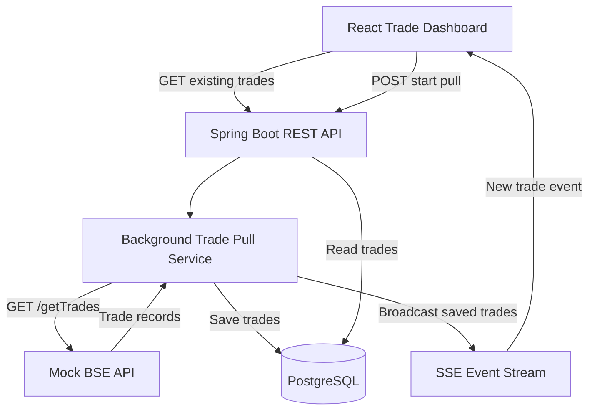

# Arham Fintech Trade Dashboard — Architecture

## 1. Overview

The Trade Dashboard is a full-stack application built using Java, Spring Boot, React, and PostgreSQL. It displays existing trade records and supports asynchronous fetching of new trades from a mock BSE exchange API.

The application uses Server-Sent Events (SSE) to notify connected dashboards when new trades have been saved.

## 2. Technology Stack

- **Frontend:** React
- **Backend:** Java and Spring Boot
- **Database:** PostgreSQL
- **Communication:** REST APIs and Server-Sent Events (SSE)
- **Build tool:** Maven
- **Development tools:** Git and GitHub

## 3. Architecture Diagram

## 4. Application Workflow

### Initial loading

1. Spring Boot starts and connects to PostgreSQL.
2. If the database is empty, the application creates initial sample trades.
3. React requests existing trades through the REST API.
4. React opens an SSE connection to receive future trade updates.
5. Existing trades are displayed without waiting for a new pull.

### Background trade pull

1. The user requests a trade pull from the dashboard.
2. The backend accepts the request and schedules the work on a separate executor thread.
3. The HTTP request returns without waiting for the simulated delay to finish.
4. The background task waits for the configured delay.
5. The service calls the mock BSE endpoint, `/getTrades`.
6. The fetched records are saved to PostgreSQL.
7. The service broadcasts a `trades` SSE event to connected clients.
8. React processes the event and updates the dashboard without a manual refresh.

## 5. API Endpoints

| Method | Endpoint | Purpose |
|---|---|---|
| GET | `/api/trades` | Retrieve stored trades |
| GET | `/api/trades/count` | Retrieve the total number of trades |
| GET | `/api/trades/stream` | Subscribe to live trade events |
| POST | `/api/trades/pull` | Start a background pull |
| GET | `/api/trades/pull/status` | Check pull status |
| GET | `/getTrades?count=2000` | Generate mock exchange records |

## 6. Configuration

The simulated delay and batch size are configurable using the Spring application properties.

The current development configuration uses a 30-second delay and a batch size of 2,000 records. For a 15-minute simulation, configure the delay to 900,000 milliseconds.

A shorter delay is useful for development and demonstrations.

## 7. Error Handling and Limitations

- A pull request is rejected if another pull is already in progress.
- The background operation does not keep the initiating HTTP request open during the delay.
- SSE connections are removed when they complete, time out, or fail.
- The mock BSE API generates sample data; it is not a connection to the real BSE exchange.
- The current implementation is intended as an assessment/demo application. Production deployment would require stronger authentication, configuration management, monitoring, and more robust retry and recovery handling.

## 8. Running the Application

Start PostgreSQL first, then start the Spring Boot backend and React frontend in separate terminals.

Refer to `README.md` for prerequisites, environment configuration, setup commands, and testing instructions.
